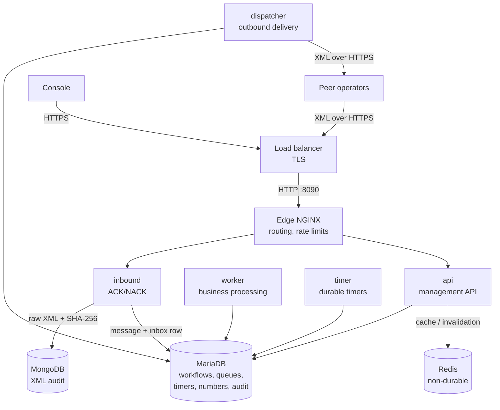

# NPG — Israeli Number Portability Gateway

[](https://github.com/greenfieldtech-nirs/npg/actions/workflows/ci.yml)
[](LICENSE.md)

A containerized gateway that lets a licensed Israeli telecom operator exchange XML number-portability
messages with the other operators: eligibility checks, porting requests, updates, cancellations,
execution, publication, number return, inquiries, maintenance notices and database synchronization.
It also gives the NOC a console to run and supervise all of it.

## What it does

- **Porting in both roles.** As **recipient**, the NOC starts a port-in (one number or a customer
  batch). The gateway then:
  - sends Check, then Request once the Check is approved;
  - schedules the port at the approved time and sends Execute when it is due;
  - takes the number over when the donor confirms;
  - publishes the new routing to every other operator, tracking each recipient's answer.

  As **donor**, it answers Check and Request under a configurable policy (automatic, or a NOC
  decision), accepts Update, Cancel and KD_update, and releases the number on Execute.
- **Every message family:** publication and its cancellation, number return with a cooling period,
  ownership inquiries, Down_system / Up_system maintenance (traffic to a peer that is down is held
  until it comes back), and database synchronization.
- **The observed wire format.** `<npMessageBody>` bodies with `X-NP-*` header fields, as seen in a
  live operator trace. Responses correlate through `requestTrxNo`. TRX and REQUEST IDs are generated
  in the trace's shape.
- **Technical ACK/NACK separate from business answers.** ACK/NACK is synchronous; business
  approval or rejection arrives as its own message. NACK HTTP statuses follow
  `docs/protocol/rejection-codes.yml`.
- **Durable, crash-safe processing** on MariaDB alone (no message broker):
  - Inbox, outbox and timer rows are claimed atomically with per-claim fencing tokens.
  - Each handler's effects commit exactly once, with stale-lock recovery and retries with backoff.
  - Messages of one process are handled strictly in arrival order.
  - Unknown deliveries are re-sent only when safe, and held for review otherwise.
- **Durable timers in working time.** Response deadlines, port execution, publication and
  maintenance windows use a configurable working calendar (Israel time zone, Friday/Saturday
  weekend, holidays). Every timer is idempotent.
- **Immutable audit:**
  - Every raw inbound and outbound XML is stored in MongoDB, with its SHA-256, before it is
    ACKed or sent.
  - Every manual action and every raw-XML view writes an audit event.
- **Security:**
  - JWT login, with roles re-checked against the database on every request.
  - Brute-force protection: per-IP and per-account limits, plus device-trust cookies.
  - Peer authentication on `/np/inbound`: IP allowlist (behind the load balancer) or a verified
    client-certificate subject, and the receiver must be us.
  - Workflows are bound to their counterparty operator.
  - Ownership changes are checked against our records, operator number ranges and the national
    numbering plan; claims nothing can verify are refused.
  - Secure-by-default configuration: production refuses to start with default secrets.
- **Israel numbering plan.** Imports the Ministry of Communications plan from data.gov.il (or an
  uploaded copy) and classifies every range with Google
  [libphonenumber](https://github.com/google/libphonenumber). The console shows the original,
  non-ported allocation of every range and operator, and looks up any number's original operator,
  libphonenumber type and porting status. Ranges libphonenumber does not recognise (M2M / IoT blocks)
  are flagged. The plan is reference data: ownership decisions still use the operator number ranges
  configured in the gateway.
- **NOC console** (React + MUI):
  - dashboard slide show: operations, the numbering plan, and platform health (stores, every runtime
    role from its heartbeat, backlog, peers);
  - workflow search and detail with state-aware actions;
  - start port-in;
  - queues and timers with retry / mark-delivered / cancel / fire-now;
  - manual task queue;
  - processes: inquiry, return, sync, maintenance;
  - operators, endpoints, number ranges, users and local setup;
  - the Israel numbering plan, also summarised on the dashboard;
  - message log with an audited raw-XML viewer.

## Architecture



One backend image runs as `api`, `inbound`, `worker`, `timer` or `dispatcher` (`APP_ROLE`; `all`
for development). MariaDB holds all durable state, including the queues. MongoDB holds raw XML.
Redis is only a cache and pub/sub bus and is never relied on for correctness.
`docs/02_TARGET_ARCHITECTURE.md` describes the design and `docs/protocol/state-machines.md` the
workflows.

## Quick start (development)

Requires Docker or Podman with Compose. No local JDK, Maven or Node.js is needed: everything builds
and runs in containers.

```bash
git clone https://github.com/greenfieldtech-nirs/npg.git
cd npg
./npg -e dev start                                  # MariaDB, MongoDB, Redis, backend (all roles), console, NGINX

curl http://localhost:19090/health/ready            # {"mariadb":"UP","mongodb":"UP","status":"UP"}
open http://localhost:8090                          # console — dev login admin / admin123
./scripts/replay-trace.sh                           # replay the real operator trace into the stack
```

Before the replay can complete a port-out, set the trace's receiver as this gateway's identity:
create operator `BZ` with **Local** checked (console → Operators, or `POST /api/operators` with
`"isLocal": true`).

| Service | Host port |
|---------|-----------|
| Console + API + inbound via NGINX | 8090 |
| Management API (direct) | 18080 |
| Inbound gateway (direct) | 18081 |
| Health / metrics (internal) | 19090 |
| MariaDB / MongoDB / Redis | 3307 / 27018 / 6379 |

### Tests

```bash
./scripts/dev-test.sh && ./scripts/test-summary.sh   # backend: 227 tests on real MariaDB/MongoDB/Redis
./scripts/frontend-check.sh                          # console: lint, typecheck, production build
```

The backend tests use separate `npg_test` databases, so a running dev stack does not interfere.
They cover:

- concurrency, fencing and crash recovery of the queues;
- exactly-once handler effects and per-process ordering;
- timers and the working calendar;
- XML security (XXE, entity expansion, size and depth limits);
- authentication, throttling and peer authentication;
- end-to-end porting in both roles, plus publication, return, inquiry, maintenance and sync
  (`e2e/`), driven through the real gateway, inbox and timers by a protocol harness that plays the
  peer operators.

## Production

1. Copy `docker/.env.production.example` to `docker/.env.production` and fill in every `REQUIRED`
   value. The stack refuses to start without them, or while any still holds the example placeholder:
   production never runs with default secrets. The first admin account is `NPG_ADMIN_USERNAME`
   (default `admin`) with the password you set in `NPG_ADMIN_PASSWORD` (at least 12 characters);
   there is no built-in production password.
2. Put the stack behind your load balancer. The LB terminates TLS and forwards plain HTTP to
   NGINX on **port 8090**, which serves everything: the console, `/api`, the operators' `/np`
   gateway and the `/health/live` health check. NGINX takes the client IP from the load
   balancer's `X-Forwarded-For` (trusted from private networks, where the load balancer sits).
3. `./npg -e production start` builds the images and starts each role as its own service, with
   healthchecks and restart policies.
4. In the console as ADMIN:
   - set this gateway's **local operator** identity;
   - add each peer with its `NPG_INBOUND` endpoint and its **IP allowlist** (the peer's source
     addresses, as the load balancer forwards them);
   - import the **Israel Numbering Plan** (console → Israel Numbering Plan → Refresh from
     data.gov.il; the backend needs outbound HTTPS to data.gov.il, or upload a downloaded copy) and
     set each operator's **numbering plan name** (Operators → edit). NPG then verifies who
     originally holds a number from the plan, and refuses publications it cannot verify;
   - add **number ranges** where you need to override the plan.
5. Keep `INBOUND_TRUST_PROXY_CLIENT_CERT=false`: TLS ends at the load balancer, so NGINX cannot
   verify peer client certificates (it always blanks those headers). If your load balancer verifies
   peer certificates, peers are still authenticated here by IP allowlist.

Metrics (Prometheus text) and readiness are served on each container's `HEALTH_PORT` (9090) and
are never routed publicly. Backups: `docker/backup-mariadb.sh` and `docker/backup-mongodb.sh`,
with credentials taken from the environment. Runbooks are in `docs/operations/runbooks/`.

### Configuration

| Variable | Default | Purpose |
|----------|---------|---------|
| `APP_ROLE` | `all` | `api`, `inbound`, `worker`, `timer`, `dispatcher` or `all` (dev) |
| `NPG_ENV` | `production` | `dev`/`test` enable development defaults; anything else is production |
| `DB_*`, `MONGO_URI`/`MONGO_DB`, `REDIS_URI` | — | datastores |
| `NPG_JWT_SECRET` | required in production | token signing key, ≥ 32 characters |
| `NPG_ADMIN_USERNAME` / `NPG_ADMIN_PASSWORD` | `admin` / required in production | first admin account (≥ 12 characters) |
| `TRUSTED_PROXIES` | none | CIDRs (or `private`) whose `X-Real-IP` / client-certificate headers are believed |
| `INBOUND_AUTH_MODE` | `strict` (`permissive` in dev) | peer authentication on `/np/inbound` |
| `NPG_HTTP_BIND` | `0.0.0.0` | interface NGINX's port 8090 is published on |
| `INBOUND_TRUST_PROXY_CLIENT_CERT` | `false` | keep `false` behind the load balancer (NGINX cannot verify client certificates) |
| `PORT_OUT_DECISION_MODE` | `MANUAL` (`AUTO_APPROVE` in dev) | how the donor answers Check/Request |
| `PORTING_KD_UPDATE_REQUIRED` | `false` | send KD_update after Request approval |
| `PORTING_DEFAULT_LEAD_MINUTES` | `15` | port time when the NOC does not request one |
| `OUTBOUND_SAFE_RESEND_TYPES` | queries and notifications | messages re-sent automatically after an unknown delivery |
| `OUTBOUND_TLS_KEYSTORE` / `_TRUSTSTORE` (+ `_PASSWORD`) | — | outbound mTLS (PKCS#12) |
| `QUEUE_CLAIM_BATCH_SIZE` / `QUEUE_LOCK_SECONDS` | `10` / `60` | queue claiming |
| `LOGIN_MAX_ATTEMPTS_PER_IP` / `_PER_ACCOUNT` | `20` / `10` | login throttling |
| `HEALTH_PORT` | `9090` | health and metrics |
| `NUMBERING_PLAN_URL` | data.gov.il plan | numbering-plan source fetched by "Refresh from data.gov.il" (https outside dev) |
| `CATALOG_PATH` | `/app/protocol` in the image | protocol model (`docs/protocol`) |

Timer durations and the working calendar are database parameters (`np_system_parameters`,
`np_working_calendar`), editable without a redeploy.

## Management API

The OpenAPI specification is in `backend/src/main/resources/openapi/npg-api.yaml`. Every route
except login and `/health/*` needs a Bearer token. Writes need MANAGER or ADMIN; configuration
needs ADMIN. Every operator action takes an audited reason.

## Project status

The gateway implements the complete protocol lifecycle for both porting roles and every message
family, with durable queues and timers, crash recovery, peer authentication, an audited NOC console
and a production container stack. It has been exercised end to end by replaying the live operator
trace into the running stack.

**Before connecting it to live peers**, confirm the protocol details that the scanned specification
and the trace leave open. They are listed in `docs/protocol/open-questions.md`; each is implemented
as configuration or an isolated rule:

- exact element names for rejections, mobile numbers and messages the trace does not show;
- the official ACK serialization;
- timer values and the working calendar;
- which messages tolerate duplicate delivery;
- the database-sync file transfer channel.

Also not built (see `docs/01_SOLUTION_SPECIFICATION.md`, out of scope for the first production
cut): BSS/OSS integration for port-out eligibility (decided by the NOC or the automatic policy),
network routing changes, billing, SSO, a SOAP transport and XSD validation (no official XSD is
available).

## Repository layout

```text
backend/     Java 21 + Vert.x backend (all roles); Flyway migrations; OpenAPI spec
frontend/    React + TypeScript + MUI console
docker/      Compose stacks, environment template, TLS notes, backup/restore
nginx/       Edge proxy configuration (dev, production)
docs/        Specification, protocol model (docs/protocol), runbooks
scripts/     dev-test, test-summary, frontend-check, replay-trace
```

## Contributing

1. Respect the [architecture](docs/02_TARGET_ARCHITECTURE.md): no external durable broker; Redis
   is cache/pub-sub only; MariaDB is the source of truth; raw XML is stored before ACK and before
   sending.
2. Treat `docs/protocol/` as the protocol source of truth. Record unresolved details in
   `docs/protocol/open-questions.md` rather than guessing.
3. Keep builds and tests containerized; `./scripts/dev-test.sh` and `./scripts/frontend-check.sh`
   must stay green.
4. Work on `feature/*` branches from `develop` (git-flow), and open an issue before large changes.

## License

Dual-licensed — see [LICENSE.md](LICENSE.md):

- **GPL-3.0** for non-commercial use and small deployments (up to 50,000 subscribers / numbers).
- **Commercial license** for larger commercial use. Contact the maintainers.

## Support

Issues: [github.com/greenfieldtech-nirs/npg/issues](https://github.com/greenfieldtech-nirs/npg/issues)
