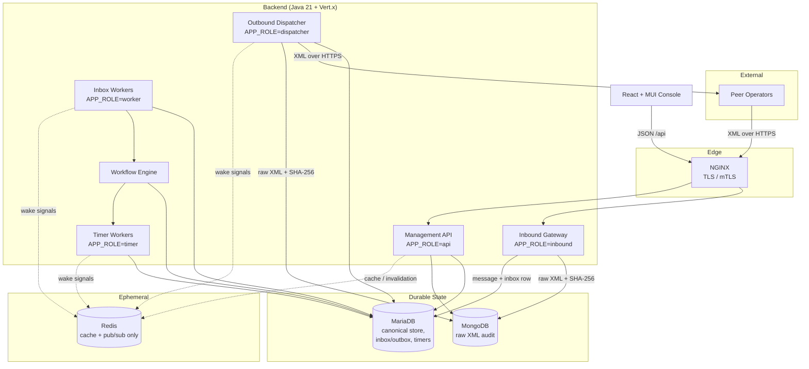

# NPG — Israeli Number Portability Gateway

[](https://github.com/cloudonix/npg.cloudonix.cloud/actions/workflows/ci.yml)
[](LICENSE.md)

A production-grade, containerized gateway enabling licensed Israeli telecom operators to exchange XML-based number-portability messages with other operators: eligibility checks, porting requests, updates, cancellations, execution, publication, number return, inquiries, maintenance notifications, and database synchronization.

## Features

- **Full protocol lifecycle** — eligibility check, porting request, update, cancel, execution, publication, return, inquiry, maintenance, and DB synchronization message families.
- **Real wire format** — accepts the observed protocol structure (`<npMessageBody>` body + header fields via `X-NP-*` HTTP headers or an XML envelope), verified against a live operator trace.
- **Technical ACK/NACK separation** — technical receipt is always distinct from business approval/rejection.
- **Durable inbox/outbox queueing** — MariaDB-backed queues with atomic claiming, retry with exponential backoff, and crash-safe recovery. No external broker required.
- **Durable timers** — database-backed timer scheduler that survives restarts and fires idempotently.
- **Immutable XML audit trail** — every raw inbound/outbound XML document is stored in MongoDB with a SHA-256 hash, linked from relational message records.
- **Idempotency enforcement** — duplicate messages are detected and rejected via database uniqueness constraints.
- **Workflow state machine** — durable, transaction-protected state transitions with a full event history.
- **Operator auto-discovery** — unknown operator codes in inbound messages self-register with a "requires configuration" flag and a console banner.
- **Login + RBAC** — JWT login with bcrypt-hashed users and three roles (Administrator / Manager / User), enforced on every route.
- **Management console** — React + TypeScript + MUI: landing page, dashboard, workflow search/detail, log viewer with correlated message lightbox, audited formatted XML viewer, operator management with local-identity section and endpoint management, user management, number lookup with prefix search.
- **Local identity configuration** — dedicated setup screen for the gateway's own operator identity and public endpoint.
- **Operational tooling** — health/readiness/metrics endpoints, backup/restore scripts, operational runbooks.

## Architecture



### Storage responsibilities

| Store | Role |
|-------|------|
| **MariaDB / MySQL** | Canonical source of truth: operators, endpoints, workflows, message metadata, inbox/outbox queues, timers, number ownership, manual tasks, audit events, users/roles. |
| **MongoDB** | Immutable raw XML audit documents with SHA-256 hashes, validation results, transport metadata. |
| **Redis** | **Non-durable only**: read-mostly cache (operator registry, system parameters) and ephemeral pub/sub (cache invalidation, worker wake signals). Never used for durable queue, workflow, timer, or message state. |

### Key design guarantees

- **Inbound ACK boundary** — before returning ACK, the raw XML is in MongoDB and the message + inbox rows are committed in a single MariaDB transaction. Business processing happens asynchronously afterward.
- **Outbound send boundary** — before anything is sent, the raw XML is in MongoDB and the message + outbox rows are committed in a single MariaDB transaction.
- **Atomic claiming** — queue and timer rows are claimed with a single `UPDATE ... WHERE status/due_at/lock` statement, then selected by `locked_by`. No `SELECT`-then-`UPDATE`; no reliance on `SKIP LOCKED`.
- **Timer safety** — timer actions are idempotent; a double-claim after a crash is a safe no-op.
- **Unknown delivery** — a dispatcher crash after send but before the DB update produces an `UNKNOWN_DELIVERY` state, surfaced for manual review.

## Tech stack

| Layer | Technology |
|-------|-----------|
| Backend | Java 21, Vert.x 4.5 |
| Canonical DB | MariaDB 10.11 / MySQL 8 |
| XML audit | MongoDB 7 |
| Cache / pub-sub | Redis 7 (non-durable) |
| Migrations | Flyway |
| Frontend | React 18, TypeScript, Vite, MUI, MUI DataGrid, TanStack Query |
| Edge | NGINX |
| Runtime | Docker, Docker Compose |
| Tests | JUnit 5, Testcontainers |

## Repository layout

```text
├── backend/            Java 21 + Vert.x backend (multi-role)
│   ├── Dockerfile
│   └── src/
│       ├── main/java/cloud/cloudonix/npg/
│       │   ├── api/           Management REST API
│       │   ├── acknack/       Technical ACK/NACK model
│       │   ├── audit/         MongoDB raw XML audit store
│       │   ├── config/        DB / Mongo / Redis / Flyway config
│       │   ├── inbound/       Inbound XML gateway
│       │   ├── number/        Number ownership service
│       │   ├── operator/      Operator status service
│       │   ├── outbound/      Outbox writer, dispatcher, transport
│       │   ├── protocol/      Protocol catalog + message model
│       │   ├── repository/    MariaDB repositories (incl. queues)
│       │   ├── retry/         Retry policy + scheduler
│       │   ├── service/       Redis cache + pub/sub services
│       │   ├── timer/         Durable timer scheduler
│       │   ├── worker/        Inbox worker
│       │   ├── workflow/      Workflow engine + handlers
│       │   └── xml/           Secure XML parsing / validation
│       └── main/resources/
│           ├── db/migration/  Flyway migrations
│           └── openapi/       Management API spec
├── frontend/           React + TypeScript + MUI console
├── docker/             Compose stacks, backup/restore, perf scripts
├── nginx/              Reverse proxy config
├── docs/               Specification and runbooks
│   ├── protocol/       Message catalog, timer matrix, state machines
│   └── operations/     Operational runbooks
└── scripts/            dev-up.sh, dev-test.sh
```

## Prerequisites

- Docker (or Podman) with Docker Compose.
- **No local JDK, Maven, or Node.js required** — all builds and tests run inside containers.

## Quick start

```bash
# Clone
git clone https://github.com/cloudonix/npg.cloudonix.cloud.git
cd npg.cloudonix.cloud

# Start the full dev stack (MariaDB, MongoDB, Redis, backend, frontend, nginx)
./npg -e dev start

# Wait for startup, then verify
curl http://localhost:18080/health/live
curl http://localhost:18080/health/ready
curl http://localhost:18080/metrics
curl http://localhost:18080/api/operators

# Management console (via nginx)
open http://localhost:8090
```

The backend runs Flyway migrations automatically at startup.

The `./npg` script is the single entry point for the stacks:

```text
./npg [-e dev|production] [-c config-file] <start|foreground|stop|rm>
```

- `start` — build and start detached (default environment: `production`)
- `foreground` — build and run in the foreground
- `stop` — stop the stack completely
- `rm` — stop the stack and remove the images it built

Configuration defaults to `docker/.env.<environment>` when present. For production, copy `docker/.env.production.example` to `docker/.env.production` and fill in real values (never commit it).

### Ports (dev stack)

| Service | Host port | Container port |
|---------|-----------|----------------|
| Management API (backend) | 18080 | 8080 |
| Inbound gateway (backend) | 18081 | 8081 |
| NGINX edge | 8090 | 80 |
| MariaDB | 3307 | 3306 |
| MongoDB | 27018 | 27017 |
| Redis | 6379 | 6379 |

## Development

### Run the backend test suite (containerized)

```bash
./scripts/dev-test.sh
```

This starts MariaDB/MongoDB/Redis, runs the full Maven test suite inside a JDK container against the running services, and exits. No local toolchain needed.

### Rebuild and restart the stack

```bash
./npg -e dev stop && ./npg -e dev start
# or directly
docker compose -f docker/docker-compose.dev.yml up --build -d
```

### Frontend development

```bash
docker run --rm -v "$(pwd)/frontend:/app" -w /app -p 3000:3000 node:20-alpine \
  sh -c "npm install && npm run dev"
```

The Vite dev server proxies `/api` to `localhost:18080` and `/np` to `localhost:18081`.

### Backend roles

One backend image runs in different roles via `APP_ROLE`:

| Role | Purpose |
|------|---------|
| `api` | Management REST API |
| `inbound` | External XML receiver (ACK/NACK) |
| `worker` | Inbox business processing |
| `timer` | Durable timer scheduler |
| `dispatcher` | Outbound outbox dispatcher |
| `all` | All roles in one process (dev only) |

### Configuration (environment variables)

| Variable | Default | Description |
|----------|---------|-------------|
| `APP_ROLE` | `all` | Runtime role |
| `DB_HOST` / `DB_PORT` / `DB_NAME` / `DB_USER` / `DB_PASSWORD` | — | MariaDB connection |
| `DB_POOL_MAX_SIZE` | `10` | DB pool size |
| `MONGO_URI` / `MONGO_DB` | — | MongoDB connection |
| `REDIS_URI` / `REDIS_ENABLED` | `redis://localhost:6379` / `true` | Redis cache/pub-sub |
| `PORT` | `8080` | Inbound gateway port |
| `API_PORT` | `8080` | Management API port |
| `CATALOG_PATH` | `docs/protocol` | Protocol catalog location |
| `APP_PUBLIC_BASE_URL` | `http://localhost:8080` | Public base URL shown on the Local Setup page |
| `NPG_JWT_SECRET` | dev default | JWT signing secret — override in production |
| `NPG_ADMIN_USERNAME` / `NPG_ADMIN_PASSWORD` | `admin` / `admin123` | Seeded admin — override in production |
| `WORKER_ID` | generated | Queue claim identity |
| `QUEUE_CLAIM_BATCH_SIZE` / `QUEUE_LOCK_SECONDS` | `10` / `60` | Queue claim tuning |
| `LOG_LEVEL` | `INFO` | Log level (structured JSON) |
| `VITE_GUEST_PAGE` (frontend build arg) | `landing` | Guest landing page vs direct login |

## Management API

OpenAPI spec: `backend/src/main/resources/openapi/npg-api.yaml`. All routes except `/api/auth/login` and `/health/*` require a Bearer JWT. Main endpoints:

| Endpoint | Description |
|----------|-------------|
| `POST /api/auth/login` · `GET /api/auth/me` | JWT login / current user |
| `GET /api/dashboard` | Aggregate counts (workflows, queues, tasks, timers) |
| `GET /api/workflows` | Search workflows (phone number, state, paging) |
| `GET /api/workflows/{uuid}` / `.../events` | Workflow detail + event history |
| `POST /api/workflows/{uuid}/manual-transition` | Manual state override (MANAGER/ADMIN, audited) |
| `GET /api/messages` | Log search (requestId, type, direction, status, date range, paging) |
| `GET /api/messages/{uuid}` / `.../pair` | Message detail / correlated request-response pair |
| `GET /api/messages/{uuid}/xml` | Raw XML retrieval (audited) |
| `GET/POST /api/operators` · `PUT /api/operators/{code}` | Operator registry (writes MANAGER/ADMIN) |
| `POST /api/operators/{code}/mark-down` | Mark operator down (MANAGER/ADMIN) |
| `GET/POST/DELETE /api/operators/{code}/endpoints[/{id}]` | Peer NPG endpoints (writes ADMIN) |
| `GET/POST /api/users` · `PUT /api/users/{username}` | User management (ADMIN, audited) |
| `GET /api/settings/local` | Local gateway settings (ADMIN) |
| `GET /api/manual-tasks` · `POST .../resolve` | Manual task queue |
| `GET /api/numbers/{phone}` · `GET /api/numbers?prefix=` · `.../history` | Number lookup, prefix search, ownership history |

## Security

- XXE, DTD, external-entity, and XML-bomb protections on all XML parsing.
- XML size and parse-depth limits (1 MB / 1000 levels by default).
- Raw XML is never written to logs; phone numbers are masked in log fields.
- **JWT login** with bcrypt-hashed users; three roles — **ADMIN** (full CRUD), **MANAGER** (peer-operator CRUD + all reads), **USER** (read-only).
- Local configuration (local operator identity, endpoint management) is ADMIN-only.
- Every manual operation and every raw XML view/download writes an audit event.
- Backend container runs as a non-root user.
- TLS/mTLS termination at NGINX (production profile); hooks exist for IP allowlists.
- Dev fallback: requests without a Bearer token may carry a legacy `X-User-Role` header (used by the test suite) — remove before production.

## Testing

```bash
# Full backend suite (82 tests: repository, concurrency, security, E2E, chaos, API, auth, simulation)
./scripts/dev-test.sh

# Frontend typecheck + build
docker run --rm -v "$(pwd)/frontend:/app" -w /app node:20-alpine \
  sh -c "npm ci && npm run typecheck && npm run build"

# Performance smoke test (requires apachebench)
docker/perf-test.sh http://localhost:18081/np/inbound 30 10

# Replay the real operator trace into the dev stack
./scripts/replay-trace.sh
```

The test suite covers: atomic queue claiming under concurrency, stale-lock crash recovery, duplicate-idempotency rejection, XXE/XML-bomb/oversized-XML rejection, timer claim/fire idempotency, workflow transition legality, end-to-end inbound porting flows, a full replay of a real operator trace (all 8 message families with correlation), and RBAC login/gating.

## Operations

- **Backup**: `docker/backup-mariadb.sh`, `docker/backup-mongodb.sh`
- **Restore**: `docker/restore-mariadb.sh`, `docker/restore-mongodb.sh`
- **Runbooks**: `docs/operations/runbooks/` (operator-down, unknown-delivery, mongodb-outage, mariadb-outage)

## CI

GitHub Actions (`.github/workflows/ci.yml`) runs three container-only jobs: backend image build + full test suite, frontend lint/typecheck/build, and full-stack bring-up with health checks.

## Project status

All planned phases (protocol foundation, database/queueing, XML audit, secure parsing, inbound/outbound gateways, workflow engine, timers, retry policy, business workflows, management API, console, containerization, QA/chaos/review) are implemented and green.

Beyond the plan, the system now also has: real wire-format parsing validated against a live operator trace, JWT login with RBAC, user management, local-operator setup, operator endpoint management, operator auto-discovery, message pairing, prefix number search, and a public landing page.

Remaining honest gaps: business handlers beyond `Check` are still minimal pending official protocol confirmation (see `docs/protocol/open-questions.md`), and outbound response generation is the next functional step.

## Contributing

Contributions are welcome. Please:

1. Respect the [key design guarantees](#key-design-guarantees) and the architecture in `docs/02_TARGET_ARCHITECTURE.md` — notably: no external durable broker; Redis is cache/pub-sub only; container-first development.
2. Treat `docs/protocol/` as the protocol source of truth, and record unresolved protocol details in `docs/protocol/open-questions.md` rather than guessing.
3. Keep all builds and tests containerized (`./scripts/dev-test.sh` must stay green).
4. Open an issue before large changes.

## License

Dual-licensed — see [LICENSE.md](LICENSE.md):

- **GPL-3.0** for non-commercial use and small-scale deployments (systems managing up to 50,000 subscribers / phone numbers).
- **Commercial license** required for commercial use at larger scale (over 50,000 subscribers / phone numbers). Contact the maintainers for commercial licensing terms.

## Support

- Issues: [GitHub Issues](https://github.com/cloudonix/npg.cloudonix.cloud/issues)
